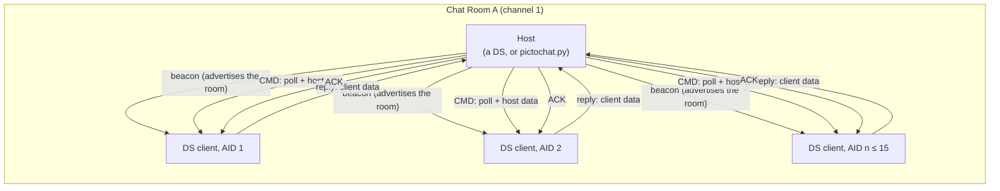
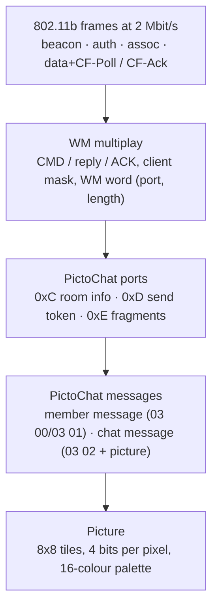
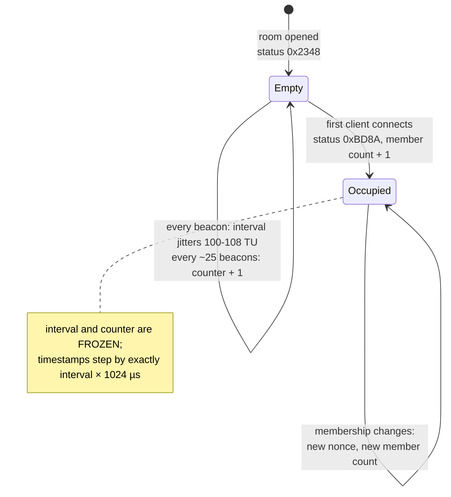
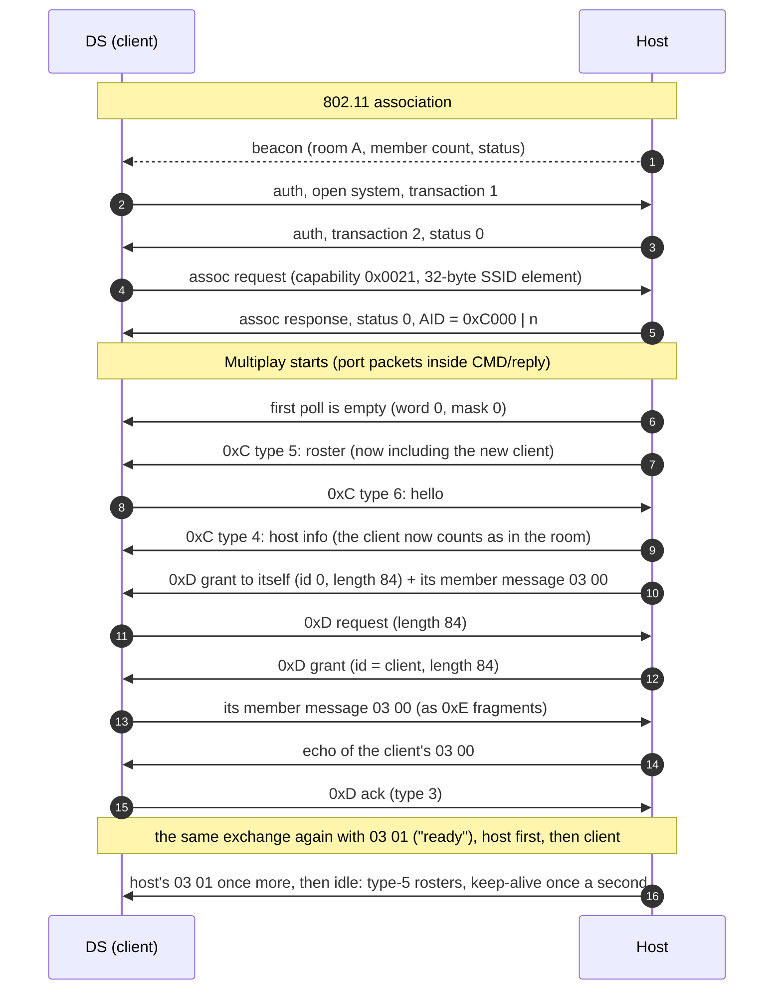
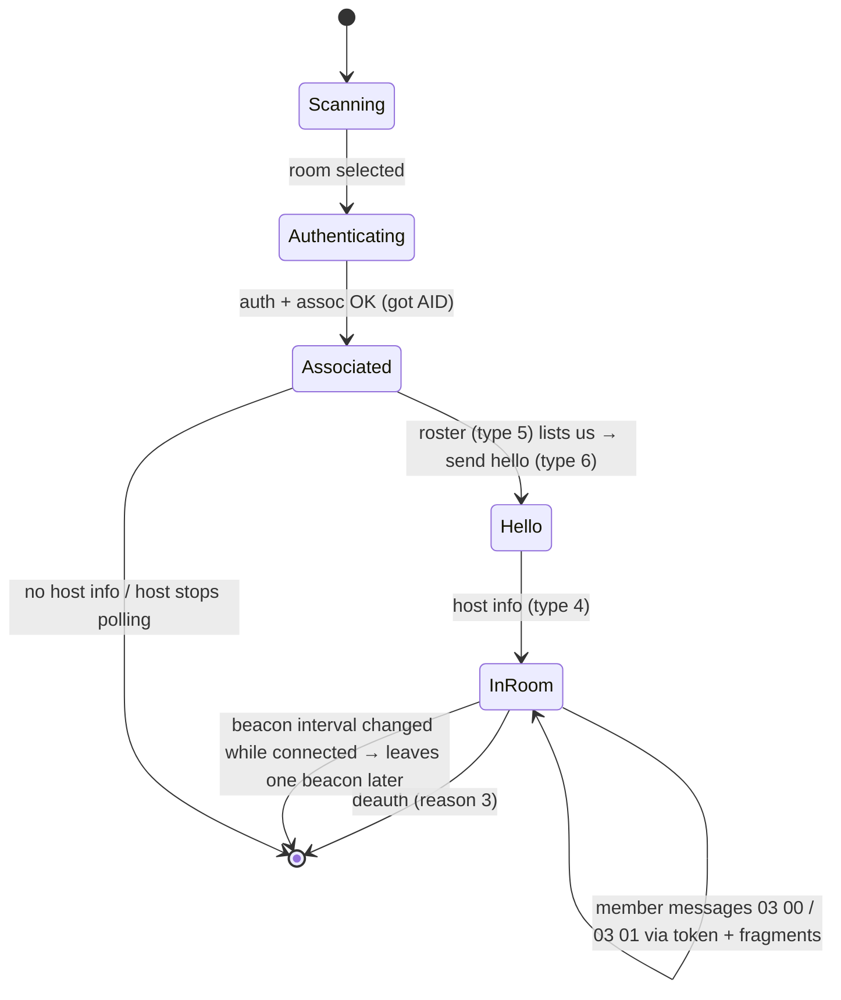
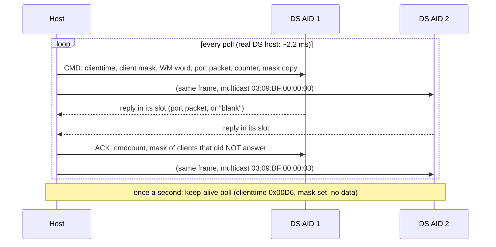
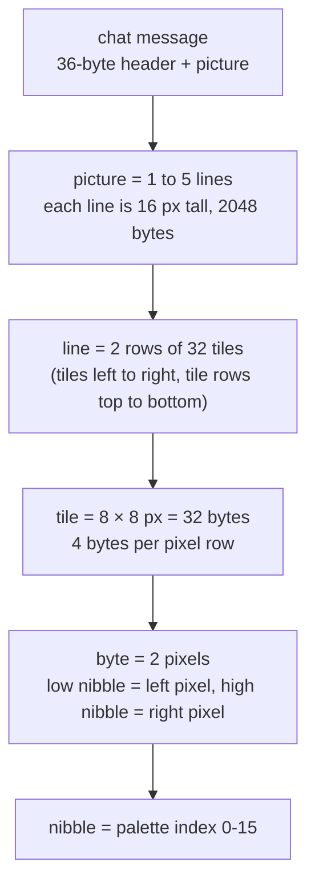
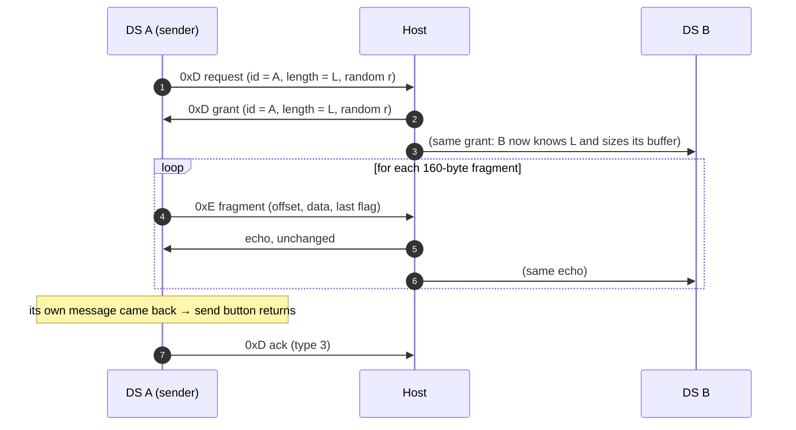
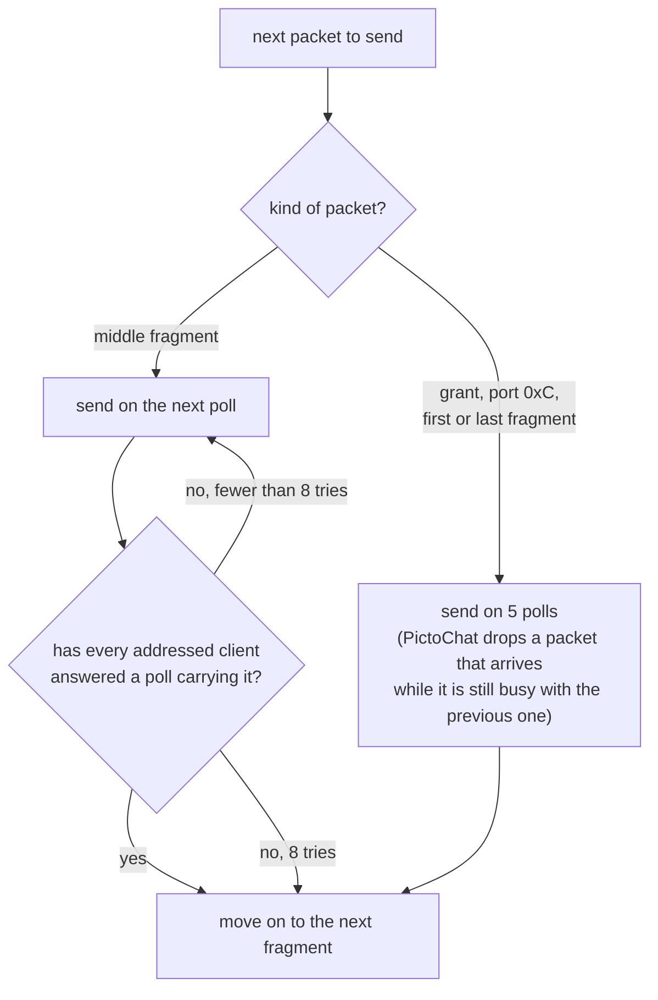

# How PictoChat works on the air

This is a description of the Nintendo DS PictoChat wireless protocol, detailed enough to write your own host. It
is what `pictochat.py` and the Rust host implement, and they work with a real DS Lite.

Each statement carries a tag that says where it comes from:
- **[real]** was seen with a real DS.
- **[emu]** was seen between two emulated DS Lites running the real firmware (melonDS core) and verified by experiment
  there.
- **[fw]** was read in the decompiled DS Lite firmware.
- **[melonDS]** comes from melonDS's Wi-Fi emulation source.
- **[guess]** is an interpretation that has not been verified.

Contents:
1. [The big picture](#1-the-big-picture)
2. [Radio and 802.11 layer](#2-radio-and-80211-layer)
3. [Beacon: advertising a room](#3-beacon-advertising-a-room)
4. [Joining a room](#4-joining-a-room)
5. [Multiplay polling](#5-multiplay-polling-cmd--reply--ack)
6. [WM ports and PictoChat packets](#6-wm-ports-and-pictochat-packets)
7. [Messages and the picture format](#7-messages-and-the-picture-format)
8. [Sending a message, end to end](#8-sending-a-message-end-to-end)
9. [Writing a host: what matters](#9-writing-a-host-what-matters)
10. [Open questions](#10-open-questions)
11. [How this was found](#11-how-this-was-found)
12. [Firmware notes](#12-firmware-notes)
13. [Sources](#13-sources)

---

## 1. The big picture

PictoChat runs on the DS wireless manager's (WM) **multiplay** layer. A room has one **host** (parent) and up to 15
**clients** (children). Each DS's radio talks only to the host, never directly to another DS.

- A host **advertises** its room with beacons. Clients join with plain 802.11 open authentication and association, and
  each gets an **AID** (association ID, 1-15).
- The host then **polls** continuously. Each poll is three frames:
  1. A CMD frame carrying the host's data and the list of clients that should answer.
  2. The clients' reply frames.
  3. An ACK frame.
- Each frame carries one WM **port packet**. PictoChat uses three ports:
  - **0xC**: room info and hello.
  - **0xD**: the send token (whose turn it is to send).
  - **0xE**: message fragments.
- **Every message goes through the host.** A sender first asks for the send token, then sends its message in fragments
  to the host. The host rebroadcasts each fragment unchanged to all clients. A client's send button stays hidden until
  its own message comes back from the host.
- **Chat messages are pictures:** 256 pixels wide, with up to 5 lines of 16 pixels each. A DS renders typed text into
  the picture itself, so there is no text encoding on the air.
- The DS radio is 802.11b at 1 or 2 Mbit/s. The DS's Wi-Fi hardware handles the microsecond timing of the
  poll/reply/ACK cycle.

The layers, from the air up:

## 2. Radio and 802.11 layer

Multiplay frames use addresses from Nintendo's address block, with the multicast bit set [fw][melonDS][real]:

| Frame | Frame control | Address 1 | Address 2 | Address 3 |
|---|---|---|---|---|
| Host CMD (poll with data) | `0x0228` data + CF-Poll, FromDS | `03:09:BF:00:00:00` | host | host |
| Client reply | `0x0118` data + CF-Ack, ToDS | host (BSSID) | client | `03:09:BF:00:00:10` |
| Host ACK | `0x0218` data + CF-Ack, FromDS | `03:09:BF:00:00:03` | host | host |
| Beacon | `0x0080` | broadcast | host | host |

- The reply address is in **address 3**, not address 1 [real].
- Everything goes out at **2 Mbit/s** [fw][real]. A DS ignores multiplay polls sent at 1 Mbit/s, even though it
  associates at 1 Mbit/s [real]. This matters for adapters whose firmware sends injected frames at the lowest rate
  (see the README).
- **The radio's own MAC must equal the host MAC** (the BSSID in the beacon) [real]. Otherwise the hardware does not
  acknowledge the DS's auth and assoc frames, and the DS keeps retrying. `pictochat.py host` sets the adapter's MAC
  before it switches to monitor mode.
- Host MACs seen: a real DS Lite used a Nintendo address (`00:1b:7a:…`). The emulated DSes used `00:09:bf:11:22:33/34`.
  Our host defaults to `00:1b:7a:00:00:01`.
- Channels: a real DS used **channel 1** for room A [real]. The emulated rooms A and B used channels 1 and 7 [emu].
  Which channel each room uses on real hardware is not fully mapped.
- Frames captured from the emulator have 4 extra FCS bytes at the end of every body.

## 3. Beacon: advertising a room

The beacon has no SSID element, so the network is "hidden" [fw][real][emu]. Its body contains, in this order:

1. Timestamp (u64), beacon interval (u16, in TU), capability `0x0021`.
2. Supported rates `01 02 82 84`, meaning 1 and 2 Mbit/s, both basic.
3. DS parameter set: the channel.
4. TIM: tag 5, length 5, holding the DTIM count, period 2, `00` and bitmap `00 00`.
5. The Nintendo vendor element: tag `0xDD`, length 32, then `00 09 BF 00`, u16 `0x000A`, u16 `0x0000`, then 24
   **game-info bytes**:

| Bytes | Content |
|---|---|
| 0-7 | `01 00 00 00 00 00 00 00` |
| 8-9 | u16 counter: +1 every ~25 beacons while the room is empty |
| 10-15 | `08 01 c0 00 c0 00` |
| 16-17 | room status: `0x2348` = room open, `0xBD8A` once a client has connected |
| 18-19 | nonce: the low 16 bits of the LCG below (**not a checksum**) |
| 20 | room index: 0-3 = Chat Room A-D |
| 21 | member count, including the host |
| 22-23 | `04 00` |

**The LCG (linear congruential generator)** [fw][real] is `s = 0x5EEDF715 · s + 0x1B0CB173 (mod 2³²)`. It also
drives the beacon-interval jitter: 100-108 TU while the room is empty, with each counter step advancing the LCG 4
times. It supplies the random values in the PictoChat packets too (section 6).

How the beacon changes over a room's life:

**After a client connects, the host freezes the beacon interval and the counter** [emu][fw]. Only the nonce changes,
and only when the membership changes. Re-randomising the interval while a client is connected makes the client leave
one beacon later [emu]. Nothing checks the nonce value itself.

## 4. Joining a room

The join looked the same with the real DS and in the emulator [real][emu]. It has an 802.11 part and a PictoChat part:

Details:
- The assoc request has an SSID element of **length 32**: 4 zero bytes, a byte counting the attempts, then zeros.
- The assoc response gives the **AID as `0xC000 | n`**. The AID selects the client's bit in the poll mask: AID 1 is
  `0x0002`, because bit 0 is never a client.
- A client leaves with a deauth, reason 3.

The client side as a state machine:

## 5. Multiplay polling (CMD / reply / ACK)

The host runs this cycle continuously. Data moves only inside it.

**CMD body** (host → all) [emu][melonDS]:

| Field | Content |
|---|---|
| u16 clienttime | `0x03E6`, the reply window per client in µs; `0x00D6` for the keep-alive poll |
| u16 client mask | which clients must answer this poll (`0x0002` for AID 1, or 0) |
| u16 WM word | `0x1000 \| port << 8 \| payload_len / 2` (bit 15 is set on some frames; its meaning is unknown and it is not needed) |
| payload | the port packet (section 6) |
| u16 counter | per-port counter: +1 on every poll that carries that port |
| u16 mask copy | **the client mask again**; a client ignores a packet if no poll carrying it addresses it |

- The very first poll after association is empty (word 0, mask 0, no tail). An empty poll is "idle".
- A real DS host addresses the clients on **every 5th poll**. It starts every new packet on an addressed poll and sends
  it on 5 consecutive polls [emu].
- Once a second the host sends a **keep-alive poll**: clienttime `0x00D6`, mask set, no data.
- A real host polls about every **2.2 ms**. The client's software needs that gap to arm its next reply [emu].

**Reply** (client → host): the body is the WM word `0x8000 | port << 8 | len/2`, the payload and a u16 reply counter.
Bit 15 of the word is usually set, but **not always**: the first hello arrived as `0x0C34`. `00 80` is an idle reply.
A client with nothing armed sends an empty ("blank") reply, which still counts as an answer.

**ACK** (host → all): the body is **4 bytes**: u16 `cmdcount` (time until the next CMD or beacon, in 10-µs units,
typically `0x54`), then a u16 mask of the clients that failed to answer.

## 6. WM ports and PictoChat packets

These are the port packets as the firmware's ARM9 GUI decodes them, all confirmed on the air [fw][emu].

**Port 0xC: room info and hello** (104 bytes): `u16 type, u16 0x68, u32 random (LCG), 0x60 bytes roster`.
The roster lists the MACs of the host and the clients, host first. Each MAC is **byte-swapped within 16-bit pairs**:
`00:1b:7a:12:34:56` becomes `1b 00 12 7a 56 34`.

| type | sent by | meaning |
|---|---|---|
| 5 | host | roster: idle traffic, with a fresh random value every 5 polls |
| 6 | client | hello, right after association |
| 4 | host | host info, the answer to a hello; the client then counts as in the room |

**Port 0xD: send token** (20 bytes): `u16 type, u16 0x14, u8 id, u8 x, u16 0xFFFF, u32 message length, u32 garbage,
u32 random`.

| type | sent by | meaning |
|---|---|---|
| 0 | client | request: id = its AID, length = the size of its message, random = a new LCG value |
| 1 | host | grant: id = whose turn it is, **length = that sender's message length**, random = the requester's value echoed, or the host's own when it grants itself |
| 3 | client | ack: sent after its own message came back from the host |

> **Pitfall:** the receiver sizes its copy buffer from the grant's length field. A wrong value there crashes the DS.
> Our first host put a random number in that field, and PictoChat froze on the real DS.

**Port 0xE: message fragment**: a 12-byte header `u16 2, u16 len (= data + 12), u8 sender id, u8 x (stack garbage),
u8 data length, u8 last-fragment flag, u32 offset`, followed by up to 160 data bytes. The host rebroadcasts every
received fragment verbatim.

## 7. Messages and the picture format

Messages are reassembled from 0xE fragments of up to 160 bytes.

**Member message** (84 bytes): `03 kind | MAC swapped (6) | UTF-16LE nickname (20 bytes) | zeros | u16 colour | 01 01`.
Kind 0 means joining and kind 1 means ready. The DS shows "Now entering ...: name".

**Chat message**: `03 02 | sender MAC swapped (6) | 00 04 00 00 00 00 | 01 04 09 0b 10 1b | 16 zero bytes | picture`.
The 6 bytes `01 04 09 0b 10 1b` were the same in every message seen. Their meaning is unknown, so they are copied as
they are.

How the picture is laid out:

- The picture is **256 px wide**. It consists of **1 to 5 lines** of 16 px, each 2048 bytes. A real DS sends only up
  to the last line that has ink: a full message is 10276 = 36 + 5 × 2048 bytes, and a 4-line one is 8228 = 36 + 4 × 2048.
- Pixels are packed in **8×8 tiles at 4 bits per pixel**: 32 bytes per tile, 4 bytes per pixel row, with the low nibble
  as the left pixel. There are **32 tiles per row**, and the rows of tiles run top to bottom.
- **Palette**: the DS displays all 16 colours. They were measured on the emulated DS by sending 16 bands [emu]
  (`emu/screenshots/palette_and_colour_image.png`):

  | Index | Colour (RGB as shown) | Index | Colour |
  |---|---|---|---|
  | 0 | paper `#fbfbfb` | 8 | yellow `#e3f300` |
  | 1 | black `#000000` (normal ink) | 9 | yellow-green `#82fb00` |
  | 2 | light grey `#d3cbc3` | 10 | green `#10fb20` |
  | 3 | magenta `#eb00eb` | 11 | cyan-green `#00fbba` |
  | 4 | pink `#fb008a` | 12 | sky blue `#00c3fb` |
  | 5 | red `#fb0028` | 13 | blue `#0079fb` |
  | 6 | red-orange `#fb4900` | 14 | deep blue `#0030fb` |
  | 7 | orange `#fba200` | 15 | violet `#2800fb` |

  Indices 3-15 are PictoChat's rainbow-pen colours. Any index can be used anywhere in a picture.
- **The visible area:** on screen the DS shows **picture columns 23-252 and rows 0-79**. The sender's name tab covers
  **columns 0-80 of rows 0-15**. Ink outside this area is invisible or is drawn over the frame, so `pictochat_gui.py`
  greys it out on the canvas and clips it before sending. Typed text starts at x = 26 on line 2.
- The layout was verified with a test picture in which every 8×4 unit carried its own index as a barcode. The positions
  were then read back from the emulator's screen [emu].

## 8. Sending a message, end to end

Here a DS sends a drawing to a room with one other DS in it:

When the **host itself** sends, for example text typed into `pictochat_gui.py`, it grants the token to itself
(id 0, length = its message length) and broadcasts its fragments.

## 9. Writing a host: what matters

Most of what made our host work came from comparing its traffic with traffic between two real-firmware DSes:

- Set the radio's **MAC to the host MAC** (section 2), and send at **2 Mbit/s**.
- After the first client connects, **freeze the beacon interval and counter** (section 3).
- The grant's **length field must be the sender's message length** (section 6).
- **Repeat the mask in the CMD tail**, and keep the ACK body exactly 4 bytes (section 5).
- **Don't require bit 15** in the reply's WM word. The first hello arrives without it.
- Count blank replies as answers.
- Send `03 01` again after the client's `03 01` (section 4).
- Send a keep-alive poll once a second.

**How our host delivers faster than a real DS host.** A real host addresses clients on every 5th poll and sends every
packet 5 times. Our host addresses **every** poll and uses the clients' replies as delivery receipts:

On the real DS this cut a full picture from about 330 polls to about 78. Measured with the Python host and a Ralink
USB adapter at about 76 polls/s: a one-line text arrives in 0.6 s, a two-line text in 0.8 s and a full picture in
1.2 s [real].

**PictoChat takes in about one packet per 16.7-ms video frame.** A fragment that is replaced sooner can be lost even
though the radio delivered it. The ESP32 offload host therefore keeps each fragment on the air for at least 25 ms.

## 10. Open questions

- What the chat header bytes `00 04 00 00 00 00` and `01 04 09 0b 10 1b` mean. The same goes for WM word bit 15, the
  part of the 0x60-byte roster after the MACs, and the ACK `cmdcount` values a real host chooses.
- How channels map to rooms on real hardware. Only room A = channel 1 has been seen.
- More than one real client: the code handles AIDs 1-15 and a mask per poll, but this is untested with real hardware.
- Colour pictures on the real DS: verified in the emulator only.

## 11. How this was found

The steps that led here, including the wrong turns:

1. **The beacon "checksum"** in bytes 18-19 resisted every CRC16 and checksum search. The firmware showed it is an LCG
   nonce.
2. **A fake host on a USB Wi-Fi adapter:** the DS accepted the beacon, but its auth retried until the adapter's MAC was
   set to the host MAC. After that, auth and assoc worked and the DS answered polls, but it deauthed after about 2 s.
3. **Reply bodies:** the reply address turned out to be in address 3. Reply bytes 6-9 are the DS's LCG state, not a
   key or a checksum.
4. **The 0xC/0xD/0xE handshake** was decoded step by step from the ARM9 firmware.
5. **Echoing the DS's own member message froze PictoChat** on the real DS. The cause, found much later in the
   emulator: our token grant carried a random number where the message length belongs, so the DS's memcpy ran wild.
6. **The emulator test bed:** the melonDS core plus our own harness, running the real firmware. Two emulated DSes chat,
   and their traffic became the reference. The Python host was attached through a TCP bridge.
7. **Emulator timing:** without lockstep, the emulated DS ran at about 0.4× real time because it waited for our 20-ms
   polls. Lockstep fixed the speed, and pacing the polls 2 ms apart in emulated time let the client arm its replies.
8. **Fixes found by diffing against the reference:**
   - Blank replies count as answers, and the ACK body is 4 bytes.
   - The CMD tail is counter + mask copy. It was first read as "who answered last".
   - WM bit 15 must not be required. The hello had been dropped, which looked like a race.
   - The host must send `03 01` again after the client's `03 01`, and send a keep-alive poll.
   - The beacon must freeze after a client connects, and the status and member count must change. A trace analysis
     found that the client left one beacon after each interval change.
9. **The picture format** was first decoded as "20-byte header, picture, 16 zero bytes". That was a 16-byte shift,
   which made text appear dashed and shifted. The barcode experiment fixed it to "header, 16 zero bytes, picture".
10. **The first messages on the real DS** worked, but they were slow and drew outside the frame. Trimming and clipping
    the pictures fixed the drawing. Addressing every poll and using replies as delivery receipts fixed the speed.

## 12. Firmware notes

Function addresses are for interoperability research. The firmware itself is Nintendo's copyrighted code and is not
part of this repository.

- The firmware was unpacked with fwunpack. The ARM7 GUI (the WM library) loads at `0x02300200`, and the ARM9 GUI
  (the PictoChat app) at `0x02358B20`.
- **ARM7:**
  - Builders: host frames `0x023091DC`, client replies `0x023095E8`, beacons `0x0230A0B4`.
  - WM state 8 is BEACON_LOST (via `FUN_02301684`) and state 9 is DISCONNECTED (via `FUN_02300a84`).
- **ARM9 (PictoChat):**
  - Connection state setter: `FUN_023694AC` (state `0xC` = error, leave the room).
  - Beacon game info: `FUN_0236B1AC`, using status codes `0x2348` (open), `0xBD8A` (connected) and `0xE34D` (keep).
  - LCG: `FUN_0236B24C`.
  - Port 0xC builders: type 6 `FUN_0236AED4`, type 4 `FUN_0236AE40`, type 5 `FUN_0236ADB4`. Handlers: host
    `FUN_0236A9E4`, client `FUN_0236A91C`.
  - Port 0xD: request `FUN_0236BECC`, dispatcher `FUN_0236C124`, grant handler `FUN_0236C23C`, ack `FUN_0236BD4C`,
    token queue `FUN_0236BD9C`.
  - Port 0xE: send `FUN_0236BC70`, receive `FUN_0236C004`.
  - ARM9 → ARM7 send: `FUN_0236C5F0`.

## 13. Sources

- melonDS (Wi-Fi emulation, and the core used for the test bed): https://github.com/melonDS-emu/melonDS
- GBATEK (DS firmware, Wi-Fi): https://problemkaputt.de/gbatek.htm
- matthil.de PictoChat notes: https://matthil.de/w/pictochat.html (partly superseded by sections 5-7)
- DS wireless hardware notes (retroisle): https://retroisle.com/others/nintendods/Technical/Firmware/wireless.php
- pictosniff 0.2 (2005): https://packetstormsecurity.com/files/38126/pictosniff-0.2.tar.bz2.html
- thesola10/pictochat: https://github.com/thesola10/pictochat
- WPI Nintendo DS wireless report: https://web.cs.wpi.edu/~claypool/mqp/ds/report.pdf
- fwunpack (fork used): https://github.com/CasualPokePlayer/fwunpack
- Espressif raw 802.11 TX: https://docs.espressif.com/projects/esp-idf/en/latest/esp32/api-guides/wifi-driver/wifi-vendor-features.html
