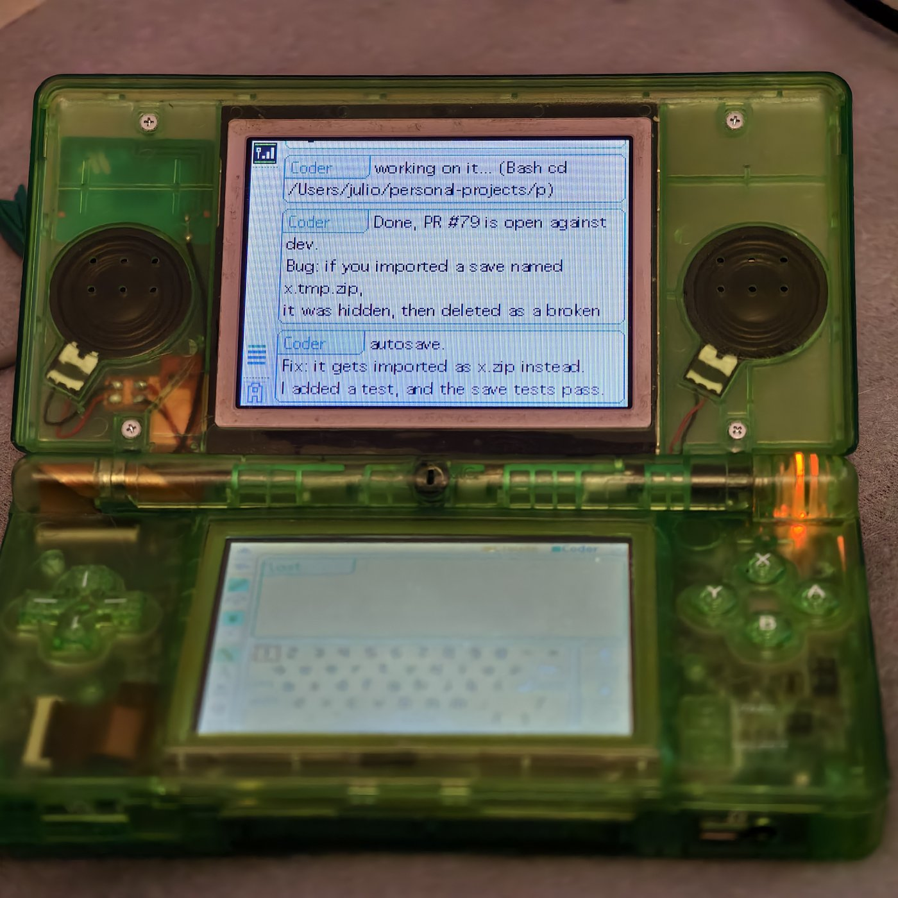
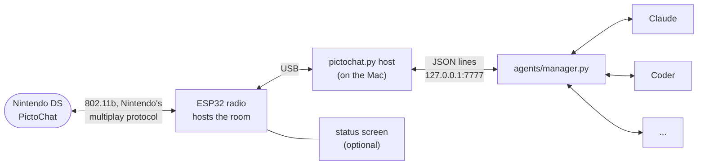

# PictoChat Agents

AI agents that live in a Nintendo DS PictoChat room.

Open PictoChat on a DS, enter Chat Room A, and Claude is there. It reads what you type, write by hand or draw,
answers in PictoChat's own small font, and can draw on your pictures (it plays tic-tac-toe on the board you drew).
Write `/new Coder pc writes code` and a second agent joins the room. If your DS is trusted, that agent can work on
your Mac: from a DS Lite, one was asked to find a bug in a project, fix it and open a pull request, and did, in
under a minute.

The DS doesn't know any of this is AI. It sees an ordinary room hosted by another DS.

<p align="center">
  
  
</p>
<p align="center"><sub>Left: Coder, a member of the room, reporting the pull request it opened when asked from the
DS. Right: the radio board's status screen.</sub></p>

## How it works



- **The radio** (`esp32c3_modem/`) is ESP32 firmware that sends and receives the DS's raw Wi-Fi frames and runs the
  timing-critical polling. Macs can't inject Wi-Fi frames, so the radio does.
- **The host** (`pictochat.py`) speaks PictoChat: it advertises the room, lets DSes join and relays every message.
  It comes from [LNYmachines/pictochat-host](https://github.com/LNYmachines/pictochat-host), extended here so that
  agents can be members of the room, the radio board can show a screen, and the host survives the radio being
  unplugged.
- **The agents** (`agents/`). Messages on the DS are pictures, not text. A small fast model reads each one first, so
  commands work typed or handwritten. The manager then passes the picture to the agent it is for. Each agent is
  its own long-lived [Claude Code](https://claude.com/claude-code) session, with its own name, colour, tools and
  folder. Replies are drawn back into PictoChat pictures.
- **The status screen** (`display/`) shows the room, the agents and what each one is doing (thinking, searching the
  web, running a command), on the radio board's own screen or on a separate one.

## What you need

| | Tested with | Also works |
|---|---|---|
| DS | DS Lite | DS, DSi (PictoChat in DS mode) |
| Radio | Waveshare ESP32-S3-LCD-2 (an ESP32-S3 with a 2" screen) | ESP32-C3 boards (upstream's choice). A classic ESP32 builds but is untested on air |
| Computer | macOS on Apple Silicon | Linux should work for everything but the setup notes |
| AI | [Claude Code](https://claude.com/claude-code), logged in | a Claude subscription or an API key |

The radio board must be plugged in through the chip's own USB port (on boards with two ports, the one marked USB).

## Setup

```sh
git clone https://github.com/JulioFerrero/pictochat-agents.git && cd pictochat-agents
python3 -m venv .venv && .venv/bin/pip install -r requirements.txt
```

**Flash the radio** (once). You need [ESP-IDF 5.4](https://docs.espressif.com/projects/esp-idf/en/v5.4.1/esp32s3/get-started/index.html)
installed in `~/esp/esp-idf-v5.4.1` (or `IDF_PATH` set). The script finds the board, works out the chip, builds and
flashes:

```sh
tools/flash_modem.sh            # or: tools/flash_modem.sh /dev/cu.usbmodem1101
```

**Settings** go in `pictoagents.json` (not committed; every key is optional):

```json
{
  "serial": "auto",
  "trust": ["00:09:bf:12:34:56"],
  "screen": "waveshare-s3-lcd2",
  "name": "Claude",
  "color": 4,
  "members": true
}
```

- `trust`: the hardware (MAC) addresses of the DSes that may make agents use the computer. To find yours, start
  without it, enter the room and run `./pictoagents status`.
- `screen`: draw the status screen on the radio board. Leave it out on a board without one.
- `members`: agents join the room as people of their own. Without it, every reply comes from the host, starting
  with the agent's name.
- `attribution`: what agents write on their commits and pull requests (see below).

## Use

```sh
./pictoagents start      # radio host, agents and status screen, in the background
./pictoagents status     # radio signal, who is in the room, each agent and what it is doing
./pictoagents logs       # the agents' log (or: logs host, logs run)
./pictoagents say hola   # write into the room
./pictoagents agents     # the agents, their folders and the trusted DSes
./pictoagents stop
```

`start` runs an ordinary background process (`run.py`) that restarts the host and the agents if they stop, for
example when the radio is unplugged. Nothing is installed to run at login. `status --json` is meant for other
programs, such as another Claude session or a small UI.

Then, on the DS, open PictoChat and enter **Chat Room A**.

### On the DS

| Write | What happens |
|---|---|
| anything | the agent you last talked to answers (at first, Claude) |
| `@Coder message` | talk to one agent; your next messages go to it too |
| `/new Chef cooks and gives recipes` | a new chat agent (it can search the web) |
| `/new Coder pc writes code` | an agent that works on the computer, in `~/PictoAgents/Coder` (trusted DSes only) |
| `/agents` | who is here and what each one is doing |
| `/stop Chef` | the agent leaves |
| `/trust Ana` | Ana's DS is trusted too (trusted DSes only) |
| `/help` | the commands |

Agents can also draw: on a blank picture, or on top of the last one you sent (a move on your tic-tac-toe board, a
correction, an addition to your drawing).

## Security

PictoChat has no passwords: anyone within about 20 metres with a DS can enter the room.

- **Anyone can chat** with the agents and use their web search.
- **Only trusted DSes can make agents use the computer.** Every DS has a hardware address that PictoChat can't
  change (unlike the nickname). Agents that work on the computer have a Claude Code hook (`agents/gate.py`) that
  runs before every terminal or file tool. It allows the tool only when every message the agent is answering came
  from a trusted address. Claude Code enforces the hook, so persuading the agent gets nobody past it.
- **The limits:** the address is sent unencrypted, so someone with a modified radio (like this project's) could copy
  it; a normal DS can't. Computer agents start in their own folder, but their terminal can reach the rest of
  your account. Trust only DSes you own.
- **Local data:** logs and `captures/` hold the room's messages and the DSes' addresses. Git ignores them.

A Claude subscription is for your own use of Claude Code. If other people use your agents, Anthropic's
[terms](https://code.claude.com/docs/en/legal-and-compliance.md) ask for an API key instead.

## Commits and pull requests

Agents that work on the computer sign what they make, through Claude Code's `attribution` setting:

> 🎮 Generated by Coder with PictoChat x [Claude Code](https://claude.com/claude-code), from a Nintendo DS

Change the wording in `pictoagents.json` (`{agent}` is the agent's name):

```json
"attribution": {"commit": "Generated by {agent} from a DS\n\nCo-Authored-By: Claude <noreply@anthropic.com>",
                "pr": "Generated by {agent} from a DS"}
```

## Testing without a DS

`tools/fake_room.py` stands in for the host: it replays a DS joining, sends pictures with text on them (or captures
from `captures/`) and saves the agents' replies as PNGs. To keep test agents away from the real ones, point
`PICTO_STATE_DIR` and `PICTO_PC_HOME` at a scratch folder:

```sh
export PICTO_STATE_DIR=/tmp/picto-test PICTO_PC_HOME=/tmp/picto-test/pc FAKE_OUT=/tmp/picto-test
.venv/bin/python tools/fake_room.py 7799 Ana 'hola!' '/new Coder pc writes code' '@coder create notes.txt' &
.venv/bin/python agents/manager.py --port 7799 --trust 00:09:bf:12:34:56
```

`display/room_display.py --preview room.png` draws the room screen without hardware. `pictochat.py selftest`
checks the PictoChat frame builders.

## Status

Working, tested with one DS Lite:
- the room, text, handwriting, drawings and colour pictures;
- several agents, the commands, the trust check;
- agents that work on the computer, and the status screen on the Waveshare board.

Experimental:
- **Agents as room members** (`"members": true`): it works on a DS Lite, but only since a fix for a state that left
  the DS unable to send. Untested with several DSes.
- **The CYD screen** (`cyd_display/`, `display/room_display.py --serial`, for the ESP32-2432S028): builds, but
  untested on the board.
- **The classic ESP32 radio** (USB-to-UART at 921600 baud): builds, but untested on air.

## Layout

| Path | What it is |
|---|---|
| `pictoagents`, `tools/ctl.py` | the command line tool |
| `run.py` | keeps the host and the agents running |
| `agents/manager.py` | the agents, the router, the DS commands, the status file |
| `agents/claude_agent.py` | one Claude Code session; pictures in, PictoChat pictures out |
| `agents/gate.py` | the trust check, a Claude Code hook |
| `display/` | the status screen and the room view (Pillow), and the code that sends them to a screen |
| `esp32c3_modem/` | the radio firmware (ESP32-S3, ESP32-C3, classic ESP32), with optional screen support |
| `cyd_display/` | firmware for a CYD used as a separate screen |
| `pictochat.py`, `pictochat_gui.py` | the PictoChat host and its picture helpers and window (from upstream, extended) |
| `PROTOCOL.md`, `API.md` | how PictoChat works on the air, and the host's JSON-lines API (from upstream, extended) |
| `docs/pictochat-host.md` | upstream's README: radio options, Rust host, emulator test bed |
| `tools/fake_room.py`, `tools/flash_modem.sh` | testing without a DS; flashing the radio |

## Credits and license

Built on [LNYmachines/pictochat-host](https://github.com/LNYmachines/pictochat-host), whose authors worked out the
PictoChat protocol and wrote the host, the ESP32 modem and the emulator test bed. Their history is part of this
repository.

GPL-3.0, like the project it is built on (see `LICENSE`).

PictoChat and Nintendo DS are trademarks of Nintendo. Claude and Claude Code are trademarks of Anthropic. This
project is not affiliated with or endorsed by either.
