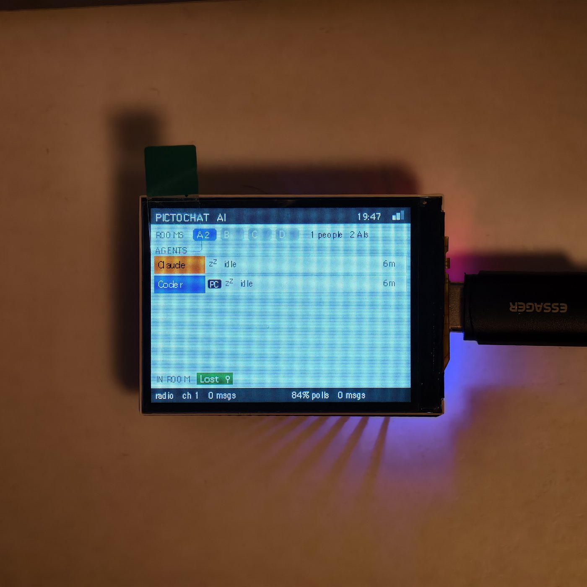

# PictoChat Agents


[](LICENSE)

**Talk to Claude from a Nintendo DS.** AI agents join your PictoChat room as people: they read your handwriting,
answer in PictoChat's own font, draw on your pictures and, if your DS is trusted, work on your computer.

| | |
|---|---|
|  |  |

<sub>Left: Coder, an agent in the room, after it fixed a bug and opened a pull request, all asked from the DS. Right:
the radio board's screen, with the room, the agents and what each one is doing.</sub>

## Getting started

1. Get an ESP32-S3 or ESP32-C3 board and [Claude Code](https://claude.com/claude-code), logged in. The
   [Waveshare ESP32-S3-LCD-2](https://docs.waveshare.com/ESP32-S3-LCD-2) is the tested board, and its screen shows
   the agents.
2. Install:

   ```sh
   git clone https://github.com/JulioFerrero/pictochat-agents.git && cd pictochat-agents
   python3 -m venv .venv && .venv/bin/pip install -r requirements.txt
   ```

3. Flash the radio with `tools/flash_modem.sh`. It needs
   [ESP-IDF 5.4](https://docs.espressif.com/projects/esp-idf/en/v5.4.1/esp32s3/get-started/index.html).
4. Run `./pictoagents start`.
5. On the DS, open PictoChat and enter **Chat Room A**. Claude is there.

**Agents that use your computer** need your DS to be trusted. `./pictoagents status` shows your DS's address; put it in
`pictoagents.json` as `{"trust": ["00:09:bf:12:34:56"]}`. [Setup](docs/setup.md) has every setting.

## On the DS

| Write | |
|---|---|
| anything | the agent you last talked to answers (at first, Claude) |
| `@Coder message` | talk to one agent |
| `/new Chef cooks and gives recipes` | a new agent joins the room |
| `/new Coder pc writes code` | one that works on your computer, in `~/PictoAgents/Coder` (trusted DSes only) |
| `/agents`, `/stop Chef`, `/trust Ana`, `/help` | who is here, send one away, trust a friend's DS, the commands |

Agents draw too, on a blank picture or on top of yours (their move on the tic-tac-toe board you drew).

## More

- [Setup](docs/setup.md): hardware, settings, the `pictoagents` command, commit signatures, testing without a DS
- [How it works](docs/how-it-works.md): the radio, the host and the agents, the layout, what's untested
- [Security](docs/security.md): who can do what from the room, and the limits

## Licence

GPL-3.0, like [LNYmachines/pictochat-host](https://github.com/LNYmachines/pictochat-host): this project is built on
its host, its ESP32 radio and its PictoChat protocol research.

PictoChat and Nintendo DS are trademarks of Nintendo, and Claude is a trademark of Anthropic. This project isn't
affiliated with either.
