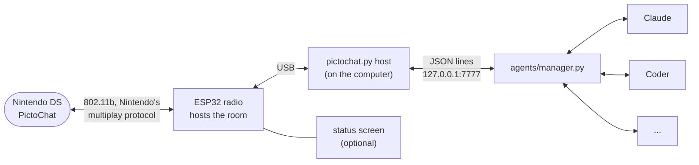

# How it works

- **The radio** (`esp32c3_modem/`) is ESP32 firmware that sends and receives the DS's raw Wi-Fi frames and runs the
  timing-critical polling. A Mac can't inject Wi-Fi frames, so the radio does it.
- **The host** (`pictochat.py`) speaks PictoChat: it advertises the room, lets DSes join and relays every message.
  It comes from [LNYmachines/pictochat-host](https://github.com/LNYmachines/pictochat-host). This repository extends
  it so that agents can be members of the room, the radio board can show a screen, and the host survives the radio
  being unplugged.
- **The agents** (`agents/`). PictoChat messages are pictures, not text. A small fast model reads each one first, so
  commands work typed or handwritten. The manager then passes the picture to the agent it is for. Each agent is its
  own long-lived [Claude Code](https://claude.com/claude-code) session, with its own name, colour, tools and folder.
  Replies are drawn back into PictoChat pictures, in PictoChat's own layout.
- **The status screen** (`display/`) shows the room, the agents and what each one is doing. It runs on the radio
  board's own screen, or on a separate CYD.

The DS doesn't know any of this is AI: it sees an ordinary room hosted by another DS. Each agent in the room has a
slot of its own, like a DS that never transmits, since every message goes through the host anyway.
[PROTOCOL.md](../PROTOCOL.md) explains PictoChat on the air, and [API.md](../API.md) covers the host's JSON-lines
port.

## Layout

| Path | What it is |
|---|---|
| `pictoagents`, `tools/ctl.py` | the command line tool |
| `run.py` | keeps the host and the agents running |
| `agents/manager.py` | the agents, the router, the DS commands, the status file |
| `agents/claude_agent.py` | one Claude Code session; pictures in, PictoChat pictures out |
| `agents/gate.py` | the trust check, a Claude Code hook |
| `display/` | the status screen and the room view, and the code that sends them to a screen |
| `esp32c3_modem/` | the radio firmware (ESP32-S3, ESP32-C3, classic ESP32), with optional screen support |
| `cyd_display/` | firmware for a CYD (ESP32-2432S028) used as a separate screen |
| `pictochat.py`, `pictochat_gui.py` | the PictoChat host, its picture helpers and its window (from upstream, extended) |
| `tools/fake_room.py`, `tools/flash_modem.sh` | testing without a DS; flashing the radio |
| [pictochat-host.md](pictochat-host.md) | upstream's README: radio options, the Rust host, the emulator test bed |

## Status

Works, tested with one DS Lite:
- the room, text, handwriting, drawings and colour pictures;
- several agents, the commands and the trust check;
- agents that work on the computer;
- the status screen on the Waveshare board;
- agents as members of the room.

Untested:
- several DSes at once with agents as members;
- the CYD screen (it builds, but hasn't run on the board);
- the classic ESP32 radio (it builds, but hasn't run on air).
