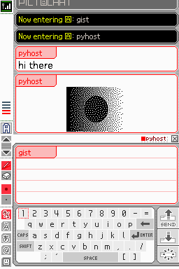
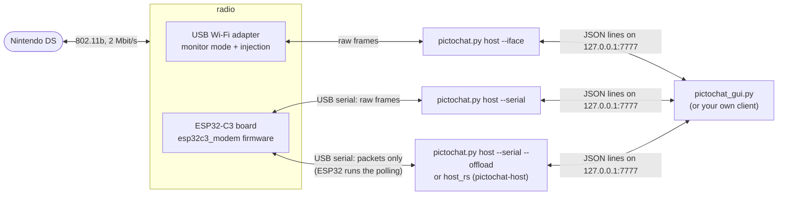

> This is the README of [LNYmachines/pictochat-host](https://github.com/LNYmachines/pictochat-host), the project this repository is built on. It describes the host (`pictochat.py`), the radio options, the Rust host and the emulator test bed. For the AI agents, see the [main README](../README.md).

# PictoChat host for  Nintendo DS

Host a PictoChat room from a PC (or a Raspberry Pi). A real DS lists the room, joins it and shows the text, drawings
and dithered pictures you send. Messages drawn on the DS come back to the PC.

- **`pictochat.py`** is the host, written in Python with only the standard library. It also captures and decodes real
  rooms.
- **`pictochat_gui.py`** is a window for sending text, drawings and pictures into the room.
- **`esp32c3_modem/`** is firmware that turns an ESP32-C3 board into the host's radio. This is the easy hardware route:
  no monitor-mode adapter is needed.
- **`host_rs/`** is the same host in Rust, for the ESP32 modem on small machines like a Pi Zero.
- **[`PROTOCOL.md`](../PROTOCOL.md)** explains in detail how PictoChat works on the air, with diagrams.
- **`emu/`** is a headless two-DS emulator test bed, built on the melonDS core.
- **[`API.md`](../API.md)** describes the JSON-lines interface for your own bots and bridges, with a minimal example in
  `examples/echo_bot.py`.



Measured on a real DS Lite: a one-line text arrives in 0.6 s, a two-line text in 0.8 s and a full-size picture in
1.2 s.

## Hardware: pick a radio

The DS speaks 802.11b at 2 Mbit/s with Nintendo's own multiplay protocol, so the radio must be able to send raw frames
with a chosen source MAC address.



| Radio | Notes |
|---|---|
| **ESP32-C3 on USB** (recommended) | Any ESP32-C3 board with native USB (USB Serial/JTAG). Flash `esp32c3_modem/`. With `--offload` the ESP32 runs the poll loop itself: 100-143 polls/s, 91-96 % answered. |
| **Nintendo Wi-Fi USB Connector** (Ralink RT2570) | Works as is in monitor mode. About 76 polls/s from Python. |
| Other monitor-mode adapters | They must inject at **2 Mbit/s**, because the DS ignores polls sent at 1 Mbit/s. Atheros AR9271 (`ath9k_htc`) sends injected frames at 1 Mbit/s unless its firmware is patched. |

## Quick start

You need Python 3 with `venv` and Tk. On Debian, Ubuntu or Mint: `sudo apt install python3-venv python3-tk`.

```
git clone https://github.com/LNYmachines/pictochat-host.git && cd pictochat-host
python3 -m venv .venv && .venv/bin/pip install -r requirements.txt   # Pillow and pyserial

# EITHER with a monitor-mode adapter: find its name with `iw dev` (e.g. wlx…); root is needed for the radio
sudo .venv/bin/python pictochat.py host --iface <wifi-interface> --channel 1 --gui-port 7777

# OR with the ESP32-C3 modem (flash it first, see esp32c3_modem/ below)
.venv/bin/python pictochat.py host --serial /dev/ttyACM0 --offload --channel 1 --gui-port 7777

# then, in a second terminal, as your normal user:
.venv/bin/python pictochat_gui.py
```

- **ESP32 serial port:** opening `/dev/ttyACM0` without root needs the `dialout` group. Run
  `sudo usermod -aG dialout $USER` once, then log out and back in.
- **What success looks like:** the host prints a status line every 5 s. When a DS joins, the log shows
  `# client 1 hello` and then `# client 1 joined`.
- **No radio yet?** `python3 pictochat.py selftest` checks the frame builders without any hardware and should end
  with `selftest OK`.
- **No git** (Raspberry Pi OS Lite ships without it)? Either `sudo apt install git`, or fetch the code with
  `curl -L https://github.com/LNYmachines/pictochat-host/archive/refs/heads/main.tar.gz | tar xz`.
- **Headless machine** (a Pi over ssh): `pictochat_gui.py` needs a display. Send from the command line instead with
  `.venv/bin/python emu/sendchat.py 7777 "text"`, or run a bot such as `examples/echo_bot.py`.

On the DS, open PictoChat and choose Chat Room A. Then, in the window:
- **Send text** types a message.
- **Send drawing** sends what you drew on the canvas.
- **Load image...** loads a picture, and **Send drawing** then sends it.

## The tools

### `pictochat.py`

- **`host`** runs the PictoChat host.
  - Room options: `--iface` or `--serial`, `--channel` (1 for room A), `--room` (0-3 = A-D), `--mac` (also set on the
    adapter), `--name` (the nickname shown on the DS, at most 10 characters) and `--color` (0-15).
  - Pace and delivery: `--poll-ms` (5), `--reply-wait` (4 ms), `--poll-cycle` and `--poll-cycle-joined` (1 / 1),
    `--hello-repeats` (8, the most copies sent of any packet) and `--no-confirm`. `PROTOCOL.md` section 9 explains the
    delivery rule.
  - ESP32 options: `--offload` and `--mp-period-ms` (7).
  - Output: `--out` (base name for the log and pcap, default `host_log`), `--all` and `--gui-port 7777`.
  - Testing: `--bridge PORT --lockstep` (emulator), `--dry-run PCAP` and `--seed`.
  - The log shows each protocol step, every frame from the DS and a status line every 5 s.
- **`capture`** sniffs a real room. It hops channels until it hears a DS, then writes a pcap and a decoded log. Type a
  label and press Enter to drop a marker into the log.
- **`analyze`** decodes a pcap.
- **`selftest`** checks the frame builders against known bytes.
- The protocol code lives in the I/O-free class `MultiplayHost` and in helpers such as `member_info_message`,
  `chat_message`, `bitmap_to_image`, `fragments`, `type1_payload`, `gameinfo`, `build_cmd` and `build_ack`.

### `pictochat_gui.py`

- **Sending:**
  - A text box with **Send text** renders the text into a picture.
  - A 256×80 canvas with **Send drawing** sends what you drew. Greyed-out areas are not shown by the DS and are
    clipped.
  - **Load image...** fits a picture file into the visible area (230 × 64 px) and dithers it with Floyd-Steinberg to
    black and white, or to the 16-colour palette when **colour** is ticked.
- A row of pen colours, with all 15 ink colours.
- A packet list with a hex dump for each packet. Received drawings are shown as pictures.
- A command line with `say`, `draw`, `clear`, `pen`, `line`, `raw <port> <hex>`, `image <file>`, `save` and `help`.
- **The GUI port** is a JSON-lines protocol on `127.0.0.1`. Other programs can use it too, such as a chatbot or a
  bridge to another room. They receive the room's packets and events, and they send messages. See
  [`API.md`](../API.md).

### `esp32c3_modem/` (ESP-IDF 5.4)

You need ESP-IDF 5.4. Install it with Espressif's
[Linux setup guide](https://docs.espressif.com/projects/esp-idf/en/v5.4.1/esp32c3/get-started/linux-macos-setup.html)
(`git clone -b v5.4.1 --recursive https://github.com/espressif/esp-idf.git ~/esp/esp-idf`, then
`~/esp/esp-idf/install.sh esp32c3`). Then, in every new terminal:

```
. ~/esp/esp-idf/export.sh            # puts idf.py on the PATH
cd esp32c3_modem
idf.py set-target esp32c3            # once
idf.py build flash -p /dev/ttyACM0
```

A board that doesn't flash may need download mode: hold BOOT, press RESET, then release BOOT.

- The modem moves raw frames between USB and the air. It sends at a fixed 2 Mbit/s with the long preamble, and it
  receives in promiscuous mode with an on-chip filter. Its station MAC is set to the host MAC, so the hardware ACKs the
  DS.
- ESP-IDF refuses to send auth and assoc responses with `esp_wifi_80211_tx`. Its sanity check is therefore replaced at
  link time (`-Wl,-zmuldefs`).
- USB framing is `AA 55 | type | u16 len | payload | xor8`. The message types are listed in `modem.c`.
- **Plain mode** (`--serial`): the PC builds every frame, polling included. That gives about 50 polls/s.
- **Offload mode** (`--offload`): the ESP32 runs the poll / reply / ACK cycle itself, and the PC only pushes and
  receives PictoChat packets. Measured with a real DS:

  | Poll interval | Polls/s | Answered |
  |---|---|---|
  | 20 ms | 50 | 92 % |
  | 10 ms | 100 | 96 % |
  | 7 ms (default) | 143 | 91 % |
  | 5 ms | 200 | 79 % |

  At 2.5 ms the DS never answered, and beacon TX failed with `ESP_ERR_NO_MEM`. Keep the PictoChat channel away from
  the channel your own Wi-Fi uses.

### `host_rs/` (Rust host for the ESP32 offload mode)

- It has the same JSON-lines GUI port as the Python host, and its packets are byte-for-byte equal to the Python
  builders, which a unit test checks.
- It assembles a message only once every byte has arrived.
- On a Pi Zero 2 W with a DS in the room it uses 0.5 % CPU and 1 MB RAM. The Python host uses 1.7 % and 15 MB.
- You need Rust: install it with [rustup](https://rustup.rs).
- Build: `cd host_rs && cargo build --release`. The binary is `target/release/pictochat-host`.
- For 32-bit Raspberry Pi OS without an ARM cross-compiler, run `rustup target add armv7-unknown-linux-musleabihf`
  once, then `cargo build --release --target armv7-unknown-linux-musleabihf`. This links statically against musl
  using rust-lld. Copy `target/armv7-unknown-linux-musleabihf/release/pictochat-host` to the Pi.
- Options: `pictochat-host --help`.

### `emu/`: two-DS emulator test bed

This is the safe place to try protocol changes. It runs two emulated DS Lites on the real firmware, either talking to
each other or to our host through a TCP bridge.

- **Build tools:** git, cmake, g++ and unzip. On Debian, Ubuntu or Mint: `sudo apt install git cmake g++ unzip`.
- **BIOS and firmware:** you need your own dumps of `bios7.bin`, `bios9.bin` and `firmware.bin` from a DS Lite. They
  are Nintendo's copyrighted code and are not included. Either copy the three files into `emu/fw/`, or pass a zip that
  contains them to `build.sh`.
- `cd emu && ./build.sh ["path/to/zip"]` clones melonDS at commit `497aa6cd`, then builds its core, the harness and
  `romrun`. It takes a few minutes.
- `./start.sh OUT.pcap 2` runs two DSes that chat with each other, which gives reference traffic.
  `./start.sh OUT.pcap 1 7778` runs one DS whose host side is a bridge for
  `pictochat.py host --bridge 7778 --lockstep`.
- **First run:**
  1. Run `./start.sh first.pcap 2`.
  2. Tap the screens with `./ctl.sh "touch 0 5 5 6" "touch 1 5 5 6"`.
  3. If the DSes show the setup wizard (a firmware without user settings), run `./wizard.sh`. It completes the wizard
     on both DSes.
  4. Check with `./shot.sh 0 menu`, which writes `menu.png`. The DS menu should show PictoChat.
- **Controlling the emulator:**
  - `./ctl.sh "cmd"` accepts `touch I X Y [frames]`, `drag`, `key I MASK frames`, `shot I file.ppm`, `reset I`,
    `fps N`, `fast on|off` and `quit`.
  - `./shot.sh I name` saves a PNG screenshot.
  - `python3 viewer.py 2` opens a live window; click the lower screen to tap it.
- **A full bridged session:** `FPS=60 ./exp.sh TAG --lockstep` starts one emulated DS and the host, joins room A and
  reports the join and the emulation speed. `./run_bridge.sh TAG [host args]` does the same without the report.
  The host's GUI port is 7790, so `../.venv/bin/python sendchat.py 7790 "text"` sends text, and
  `../.venv/bin/python ../examples/echo_bot.py 7790` runs the example bot. Both need Pillow, so use the venv.
  The live host log is `TAG.log`. To run a second checkout at the same time, give it its own ports:
  `BRIDGE_PORT=7878 GUI_PORT=7890 ./exp.sh TAG --lockstep`.
- **Draw and send on the emulated DS:** `./ctl.sh "drag 0 100 45 200 80 30"` draws a line, and
  `./ctl.sh "touch 0 238 116 8"` presses SEND. A stroke must start below the nickname tab in the top-left corner of
  the drawing area, or PictoChat ignores it. The host log then shows `DS message complete`; at emulator speed this
  can take half a minute.
- **Stop everything:** `./stop.sh`. It stops only the harness and host that these scripts started.
- **Analysis:** `flow.py PCAP t0 t1 [--no-fcs]` prints a compressed packet flow, and `early.py PCAP N` lists the frames
  after association.
- **Pitfalls:**
  - The emulator does not advance time while it waits for the bridge, so use `--lockstep`.
  - A one-instance harness must not be sent commands for instance 1.
- `romrun.cpp` is a headless runner for homebrew `.nds` files: scripted keys, touch input, screenshots and an emulated
  SD folder.

## Running on the real DS

- After a host restart, a DS that is still in the room sends a few deauths, then rejoins within about 2 s.
- If the host was away for longer, the DS opens the room itself and stays there alone. Leave the room on the DS and
  enter it again to get back to the host.
- Only one host can use a modem. A second one on the same serial port is refused. If the host runs as a service,
  stop the service before starting another host by hand.
- If the DS drops out, try `--poll-ms 10` or `--no-confirm`. A frozen DS needs a power cycle.
- Logs: `host_log.log` and `host_log.pcap`. Wireshark opens the pcap, and `pictochat.py analyze` decodes it. Captures
  contain the real MAC addresses of your devices, so think twice before publishing them.

## License

GPLv3 (see `LICENSE`). `emu/harness.cpp` and `emu/romrun.cpp` link against melonDS, which is GPLv3 as well.
PictoChat and Nintendo DS are trademarks of Nintendo. This project is not affiliated with or endorsed by Nintendo.
